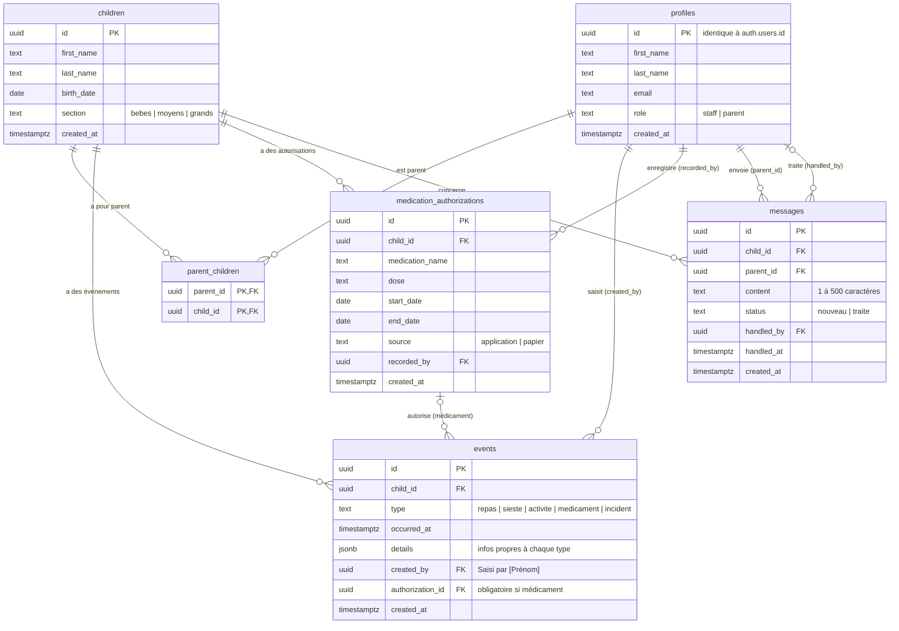

# Modèle de données – Les Petits Pas

Base : Supabase (PostgreSQL). Toutes les tables sont protégées par RLS.

## Règles métier

- **Médicament** : un événement `medicament` exige une autorisation valide (bon enfant, date comprise entre `start_date` et `end_date`). Contrôlé par la base (trigger).
- **Rôles** : tout nouveau compte est `parent` par défaut (trigger). Le rôle `staff` est attribué manuellement.
- **Staff** : voit et modifie tout.
- **Parent** : voit uniquement ses enfants, leurs événements et autorisations, et ses propres messages. Il peut envoyer un message ou créer une autorisation, mais pas créer d'événement.